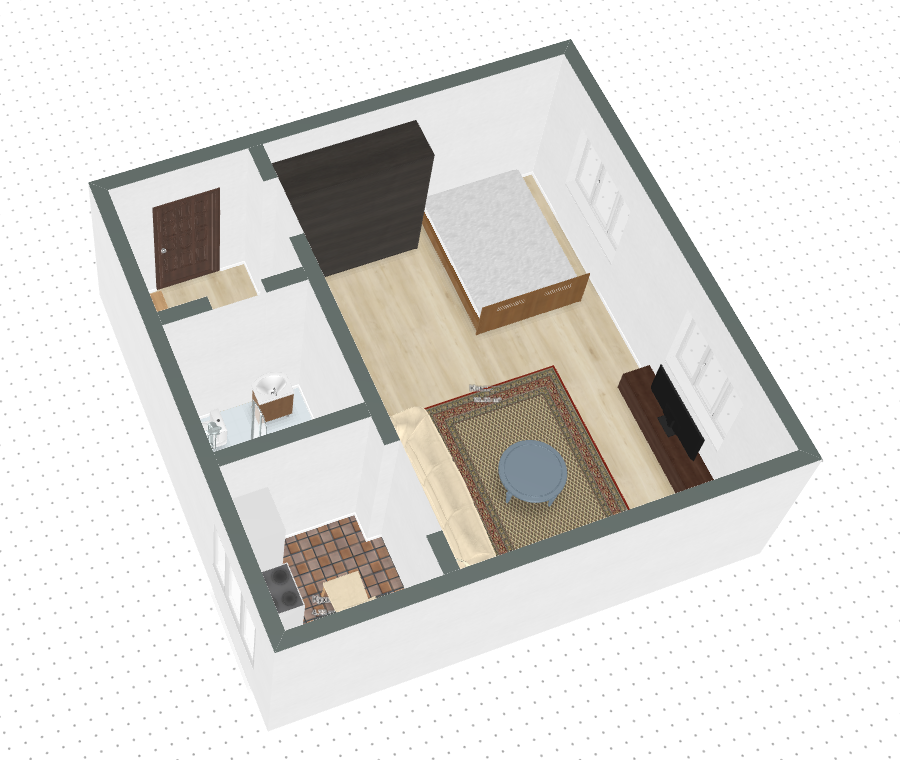
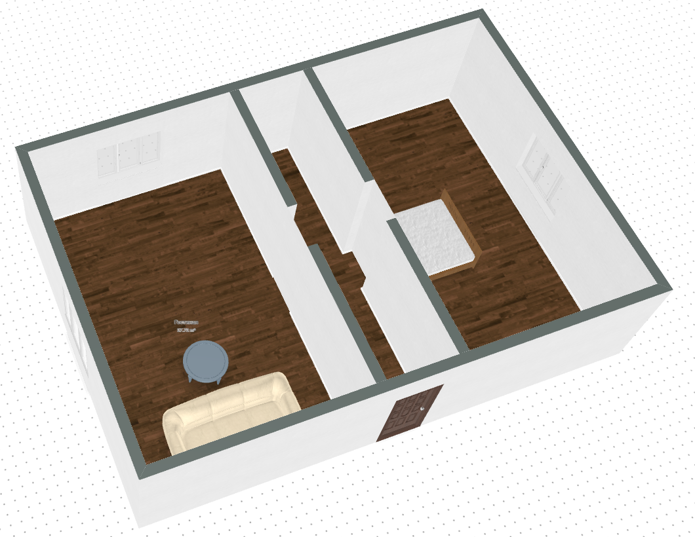
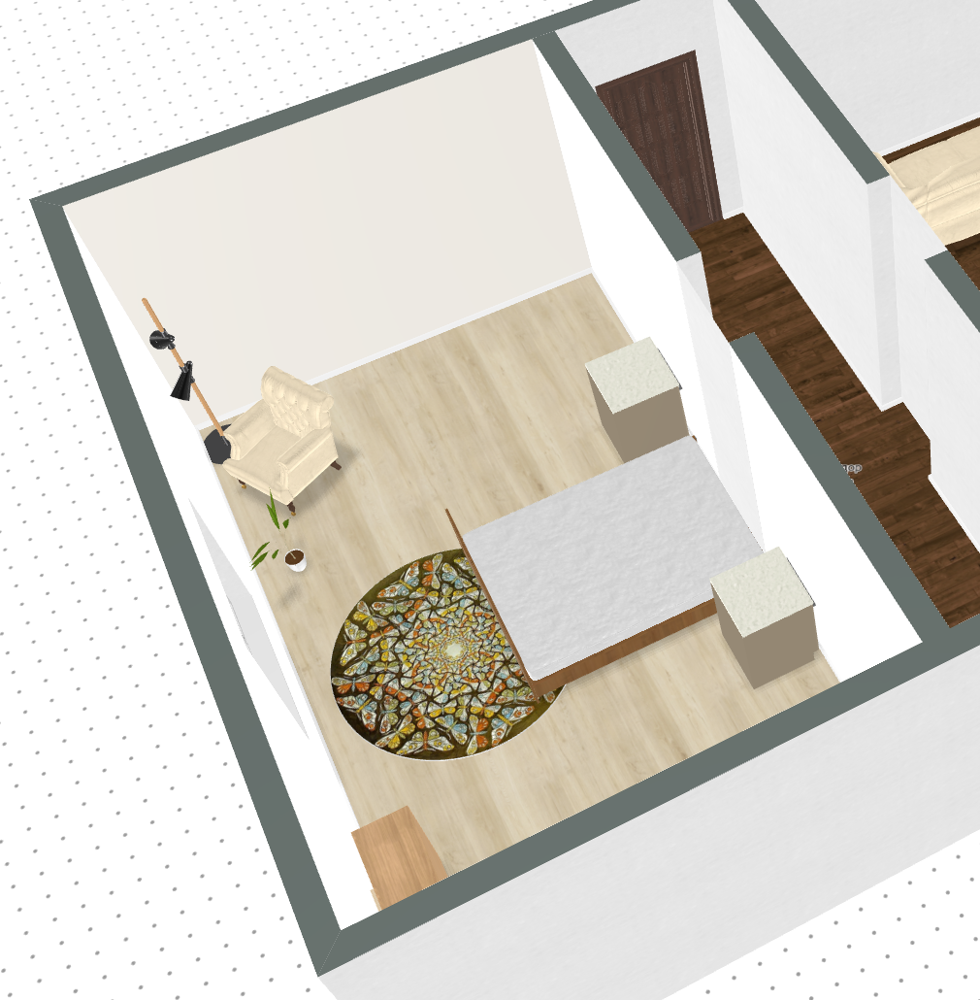

# roomtodo-mcp

An unofficial [MCP](https://modelcontextprotocol.io) server for the [roomtodo.com](https://roomtodo.com) 3D room planner.
Ask Claude or Codex to lay out a flat, furnish it, put doors and windows into walls and pick floors and wall colours,
then open the result in roomtodo.



> Unofficial: not affiliated with roomtodo. It uses the same web API as the planner, reconstructed from the
> site itself, so it can break when the site changes.

[Russian ↓](#russian)

## Setup in 3 steps

### 1. Download

Open [Releases](../../releases), download the archive for your system and unpack it, for example to
`C:\Tools\roomtodo-mcp\`. Inside is a single program, `roomtodo-mcp` (`roomtodo-mcp.exe` on Windows). It needs
nothing else.

| System | Archive |
|---|---|
| Windows | `roomtodo-mcp-…-windows-amd64.zip` (`arm64` for ARM laptops) |
| macOS, Apple Silicon | `roomtodo-mcp-…-darwin-arm64.tar.gz` |
| macOS, Intel | `roomtodo-mcp-…-darwin-amd64.tar.gz` |
| Linux | `roomtodo-mcp-…-linux-amd64.tar.gz` |

On macOS, allow the downloaded program to run once:

```bash
xattr -d com.apple.quarantine /path/to/roomtodo-mcp
```

### 2. Connect it to your assistant

Replace the path with the place where you unpacked the program.

**Claude Desktop.** Open Settings → Developer → Edit Config, add the `roomtodo` entry and restart Claude:

```json
{
  "mcpServers": {
    "roomtodo": {
      "command": "C:\\Tools\\roomtodo-mcp\\roomtodo-mcp.exe"
    }
  }
}
```

**Claude Code:**

```bash
claude mcp add roomtodo -- C:/Tools/roomtodo-mcp/roomtodo-mcp.exe
```

**Codex (CLI and IDE extension):**

```bash
codex mcp add roomtodo -- C:/Tools/roomtodo-mcp/roomtodo-mcp.exe
```

Or add it to `~/.codex/config.toml` by hand:

```toml
[mcp_servers.roomtodo]
command = 'C:\Tools\roomtodo-mcp\roomtodo-mcp.exe'
```

### 3. Ask for something

For example: *"Using roomtodo, build a one-room apartment of 40 m² in apartment.json and furnish it."*

The assistant saves the project as a file. To look at it:

1. Open <https://roomtodo.com/planner>. You don't need an account.
2. Press **Ctrl+Alt+O** and pick the file. Files are in `~/.roomtodo-mcp/projects` unless you gave a full path.
3. Switch to **3D** in the bottom-right corner.

## Example prompts

The server also ships these as ready-made prompts. In Claude Desktop they are in the **+** menu, and in Claude Code
they are slash commands such as `/mcp__roomtodo__one_room_apartment`.

**One-room apartment of 40 m²** (`one_room_apartment`)

> Design a one-room apartment of about 40 m² in apartment.json: a living room with a sleeping area, a kitchen,
> a bathroom and an entrance hall. Add an entrance door, windows and free furniture, tiles in the bathroom.

Result: the picture at the top. It has a hall with the entrance door, a bathroom with a shower, a kitchen with a
fridge and a stove, and a room with a wardrobe, bed, sofa, rug, coffee table and TV by the windows.

**House with a corridor** (`house_with_corridor`)

> Build a small house in house.json: a living room and a bedroom on both sides of a corridor, doorways from the
> corridor, an entrance door, a window in every room, a sofa and a bed.



**Furnish a room in a style** (`furnish_room`)

> Furnish the bedroom in house.json in a Scandinavian style.



Some more prompts to try:

- *"Make a two-room flat of 55 m² with a separate kitchen and a bathroom next to the hall."*
- *"Open my roomtodo project 123456 and add a desk and a bookshelf to the study."*
- *"Paint the living room walls #e8e2d6 and put light oak on the floor."*
- *"Copy this shared project into my account: https://roomtodo.com/planner/project/…"*

## Your roomtodo account (optional)

Everything above works without an account. Sign in only if you want projects saved straight into *My projects*
on roomtodo:

- **Automatic:** ask for something that needs the account (for example *"list my roomtodo projects"*). A separate
  Chrome/Edge window opens on roomtodo.com. Sign in as usual and the window closes by itself. Later sign-ins are
  usually silent.
- **With a token:** start the program with `--token <token>`, or set `ROOMTODO_TOKEN`. The token is the value of
  `localStorage["r2d_token_…"]` on roomtodo.com.

The token is cached in `~/.roomtodo-mcp/token.json`. Ask the assistant to *log out of roomtodo* to remove it.

## What it can do

| Tool | |
|---|---|
| `create_floorplan` | walls, rooms and doorways from rectangles |
| `add_object`, `move_object`, `remove_object` | furniture; doors and windows snap into the nearest wall |
| `set_material`, `set_walls_height` | floor, ceiling and wall materials or colours, and wall height |
| `search_catalog`, `category_tree` | the roomtodo catalog (no account needed) |
| `get_project`, `new_project`, `save_project_as`, `list_projects` | open, create, copy between file, account and share link |
| `rename_project`, `share_project`, `delete_project` | account projects |
| `login`, `logout`, `whoami` | account |
| `list_renders`, `get_render` | renders |

A project can be a `.json` file name, an account project id, or a share link. Coordinates are centimetres, with x
to the right and y down the plan. The assistant handles these details itself.

## Options

All options are optional.

| Flag | Environment variable | Default | |
|---|---|---|---|
| `--projects-dir d` | `ROOMTODO_PROJECTS_DIR` | `~/.roomtodo-mcp/projects` | where project files go |
| `--state-dir d` | `ROOMTODO_STATE_DIR` | `~/.roomtodo-mcp` | token and sign-in browser profile |
| `--token t` | `ROOMTODO_TOKEN` | | roomtodo token |
| `--lang l` | `ROOMTODO_LANG` | `ru` | catalog language |
| `--browser p` | `ROOMTODO_BROWSER` | auto | Chrome/Edge for sign-in |
| `--no-browser-login` | `ROOMTODO_NO_BROWSER_LOGIN` | | never open a browser |

To pass options in Claude Desktop, add `"args": ["--projects-dir", "D:\\Rooms"]` next to `"command"`.

## Build from source

```bash
go build -o roomtodo-mcp ./cmd/roomtodo-mcp
go test ./...          # -short skips the test that needs network
```

Releases are built by GitHub Actions when a `v*` tag is pushed.

---

## Russian

Неофициальный MCP-сервер для планировщика [roomtodo.com](https://roomtodo.com). Попросите Claude или Codex
спланировать квартиру, расставить мебель, вставить двери и окна и подобрать полы и цвет стен, а потом откройте
результат в roomtodo.

### Установка за 3 шага

1. **Скачайте** архив под свою систему из [Releases](../../releases) и распакуйте, например, в
   `C:\Tools\roomtodo-mcp\`. Внутри одна программа, больше ничего ставить не нужно.
2. **Подключите** её к ассистенту (путь замените на свой):
   - **Claude Desktop:** Settings → Developer → Edit Config, добавьте блок `roomtodo` из примера выше и
     перезапустите Claude.
   - **Claude Code:** `claude mcp add roomtodo -- C:/Tools/roomtodo-mcp/roomtodo-mcp.exe`
   - **Codex:** `codex mcp add roomtodo -- C:/Tools/roomtodo-mcp/roomtodo-mcp.exe`
3. **Попросите**, например: *«Сделай в roomtodo однокомнатную квартиру 40 м² в apartment.json и обставь её»*.
   Чтобы посмотреть результат, откройте <https://roomtodo.com/planner> (аккаунт не нужен), нажмите
   **Ctrl+Alt+O**, выберите файл и переключитесь на **3D**. Файлы лежат в `~/.roomtodo-mcp/projects`.

### Готовые промпты

Они встроены в сервер: в Claude Desktop они в меню **+**, в Claude Code это команды вида
`/mcp__roomtodo__one_room_apartment`. Скриншоты результатов выше.

- **«Однокомнатная квартира 40 м²»:** планировка, дверь, окна, мебель и плитка в санузле.
- **«Дом с коридором»:** две комнаты по сторонам коридора, проходы, дверь, окна, диван и кровать.
- **«Обставь комнату в стиле…»:** например, *«Обставь спальню в house.json в скандинавском стиле»*.

### Аккаунт roomtodo (по желанию)

Всё выше работает без аккаунта. Войти нужно, только если хотите сохранять проекты прямо в «Мои проекты»:

- **Автоматически:** при первой такой просьбе откроется окно Chrome или Edge. Войдите, и оно закроется само.
- **Токеном:** запустите программу с `--token` или задайте `ROOMTODO_TOKEN`.

## License

MIT
